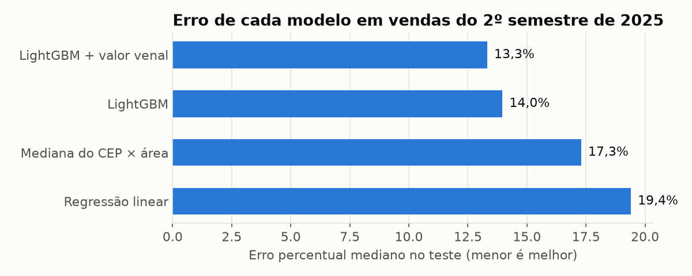
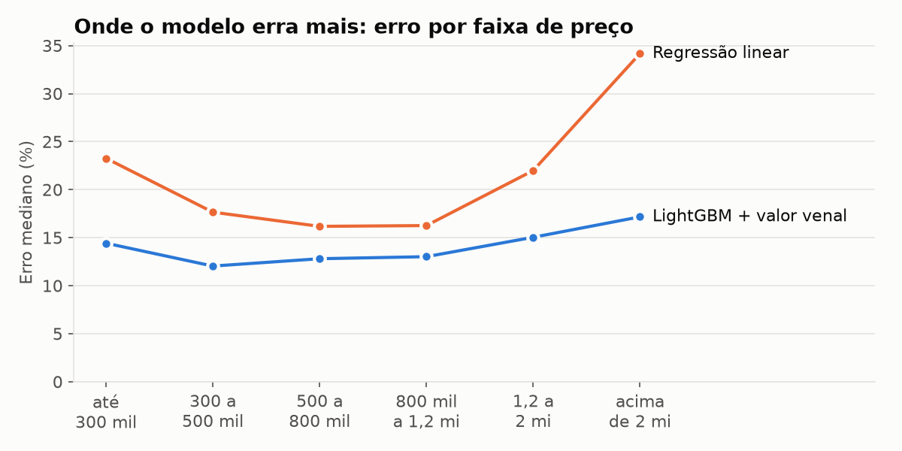
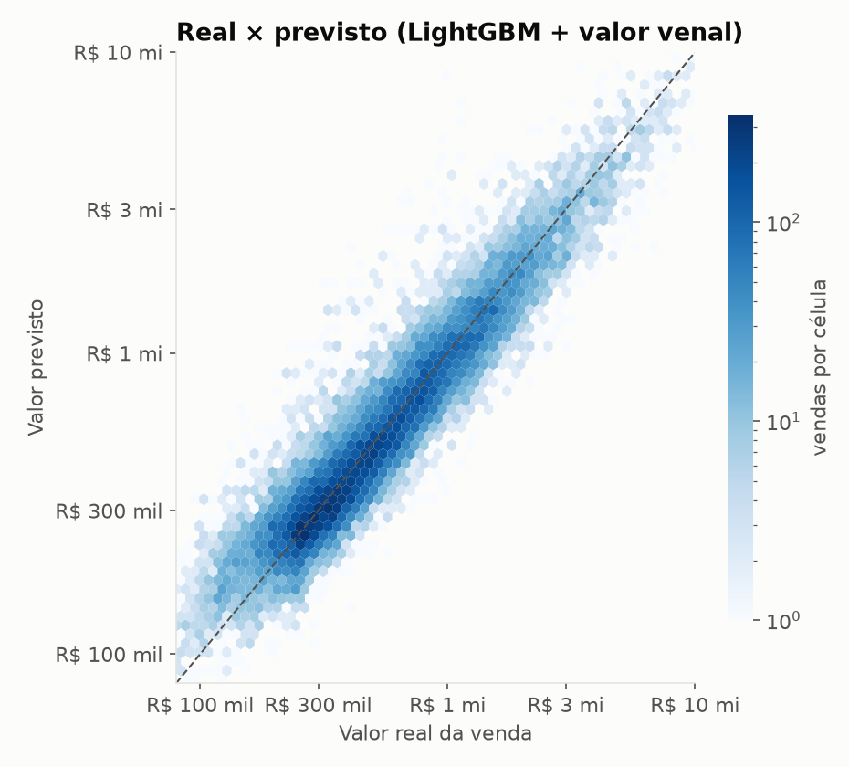
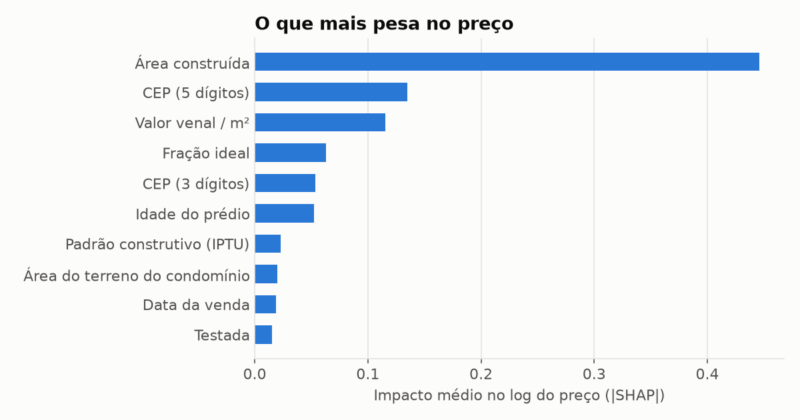

# itbi-sp

Previsão do preço de apartamentos em São Paulo usando as **vendas reais** registradas nas guias de ITBI pagas à prefeitura, e não preço de anúncio.

A maioria dos projetos de "previsão de preço de imóveis" usa dados de portais de anúncio, onde o preço é o que o vendedor *pede*. Aqui o alvo é o valor declarado na escritura de compra e venda, publicado pela Secretaria da Fazenda de SP com cadastro do IPTU (área, padrão construtivo, ano de construção) e CEP.

## Resultado

Treino com vendas de jan/2024 a jun/2025 (88.683 apartamentos), teste com vendas do 2º semestre de 2025 (31.229). A divisão é **temporal**: o modelo nunca vê o futuro.

| Modelo | Erro mediano | Dentro de ±10% | Dentro de ±20% | R² (log) |
|---|---:|---:|---:|---:|
| Mediana do CEP × área | 17,3% | 31% | 56% | 0,840 |
| Regressão linear | 19,4% | 27% | 51% | 0,819 |
| LightGBM | 14,0% | 38% | 66% | 0,887 |
| LightGBM + valor venal | **13,3%** | **39%** | **67%** | **0,894** |



O que deu pra tirar disso:

- **A regressão linear perde para a regra de bolso** "preço/m² mediano do CEP × área". Localização em SP não é linear: o mesmo apartamento muda de preço por quarteirão, e o modelo linear só consegue somar efeitos.
- **O LightGBM resolve boa parte disso**, principalmente nos imóveis caros, onde a linear chega a errar 34% na mediana.
- **O valor venal de referência ajuda pouco** (de 14,0% para 13,3%). A maior parte da informação já está em área, CEP e características do prédio.







## Dados

Fonte: [Prefeitura de São Paulo, Guias de ITBI pagas](https://prefeitura.sp.gov.br/web/fazenda/w/acesso_a_informacao/31501). São planilhas anuais com uma aba por mês e cerca de 220 mil guias por ano.

Pegadinhas que apareceram no caminho:

- algumas abas não têm cabeçalho e outras repetem o cabeçalho no meio dos dados; a leitura é feita por posição de coluna (`src/itbi/ingest.py`);
- em alguns meses a coluna "Descrição do padrão" vem com o nome de outra coluna;
- tem guia com proporção transmitida de 31 milhões % e venda de apartamento por R$ 0,01;
- a guia é paga depois da escritura, então vendas de dezembro só aparecem completas no arquivo do ano seguinte.

Recorte usado (`src/itbi/clean.py`): compra e venda, apartamento, 100% do imóvel transmitido, área entre 20 e 600 m², R$/m² entre 1.500 e 60.000 e preço entre 0,3× e 5× o valor venal. Sobram ~120 mil vendas.

## Features

| Feature | Origem |
|---|---|
| área construída (log) | cadastro IPTU |
| idade do prédio | ano da venda − ano de construção |
| padrão construtivo (A–F) | unidade do código de padrão do IPTU |
| área do terreno, fração ideal, testada | cadastro IPTU |
| CEP 5 e 3 dígitos | target encoding com validação cruzada |
| data da venda | meses desde jan/2024 |
| valor venal / m² (log) | só no último modelo |

## Como rodar

```bash
python -m venv .venv
source .venv/bin/activate   # Windows: .venv\Scripts\activate
pip install -e ".[dev]"

python -m itbi.download     # ~80 MB, planilhas 2024 e 2025
python -m itbi.ingest       # xlsx -> data/interim/itbi.parquet
python -m itbi.train        # treina, salva models/ e metrics.json
python -m itbi.report       # gera as figuras em docs/img/

pytest
```

A exploração inicial está em [`notebooks/01_exploracao.ipynb`](notebooks/01_exploracao.ipynb).

## Estrutura

```
src/itbi/
  download.py   baixa as planilhas da prefeitura
  ingest.py     lê as abas mensais e normaliza
  clean.py      recorte de apartamentos e limpeza
  features.py   engenharia de features
  train.py      treino e avaliação temporal
  report.py     figuras
notebooks/      exploração
tests/
```

## Limitações e próximos passos

- Não há coordenadas, só CEP. Geocodificar os CEPs e usar distância ao metrô deve ajudar bastante.
- Não há número de quartos, vagas nem andar. O cadastro do IPTU não traz essas informações.
- O valor é o **declarado** pelo comprador. Existe subdeclaração, que o filtro de 0,3× do venal só pega nos casos extremos.
- Os arquivos de 2026 já estão saindo; dá para usá-los como um segundo teste fora do tempo.
